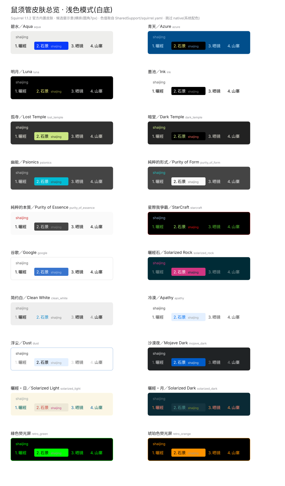
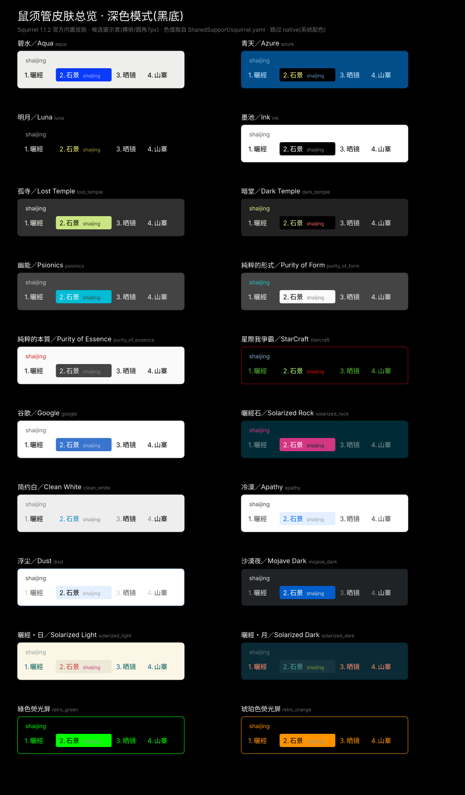

# Squirrel-Skin-Collection

个人整理的 Rime 鼠须管皮肤收集大全，其中包含了所有 Rime 原生皮肤。

## 🎨 皮肤预览

> 预览图基于 **Squirrel 1.1.2** 官方内置配色定义（`Squirrel.app/Contents/SharedSupport/squirrel.yaml`）生成，
> 色值取自真实配置（Rime 的 `0xBBGGRR` 格式已转换为 RGB）。
> 候选窗为横排（`candidate_list_layout: linear`）、圆角 7px 的示意渲染，非像素级截图；实际效果以部署后为准。

### 浅色模式（白底）



### 深色模式（黑底）



收录皮肤（20 套）：碧水 aqua ｜ 青天 azure ｜ 明月 luna ｜ 墨池 ink ｜ 孤寺 lost_temple ｜ 暗堂 dark_temple ｜ 幽能 psionics ｜ 純粹的形式 purity_of_form ｜ 純粹的本質 purity_of_essence ｜ 星際爭霸 starcraft ｜ 谷歌 google ｜ 曬經石 solarized_rock ｜ 简约白 clean_white ｜ 冷漠 apathy ｜ 浮尘 dust ｜ 沙漠夜 mojave_dark ｜ 曬經・日 solarized_light ｜ 曬經・月 solarized_dark ｜ 綠色熒光屏 retro_green ｜ 琥珀色熒光屏 retro_orange

### 启用方法

编辑 `squirrel.custom.yaml`，取消对应皮肤行的注释即可，例如：

```yaml
patch:
  style/color_scheme: aqua
  # style/color_scheme_dark: mojave_dark   # 深色模式下使用的皮肤
```

保存后在菜单栏鼠须管图标中选择「重新部署」生效。

### 重新生成预览图

预览图由脚本自动生成（含 `0xBBGGRR → RGB` 转换），可随官方版本更新重新生成：

```bash
python3 scripts/gen_svg.py \
  "/Library/Input Methods/Squirrel.app/Contents/SharedSupport/squirrel.yaml" \
  previews/
```

### 说明

- `nord_dark`、`milan`、`purity`、`calm`、`mritd_dark` 等为社区皮肤，Squirrel 官方不带其配色定义，故暂无预览；欢迎 PR 补充（请附配色定义来源）。
- `native`（系统配色）跟随系统外观，无固定色值，未生成预览。

---

*原始说明：个人整理的Rime鼠须管皮肤收集大全，其中包含了所有Rime原生皮肤*
